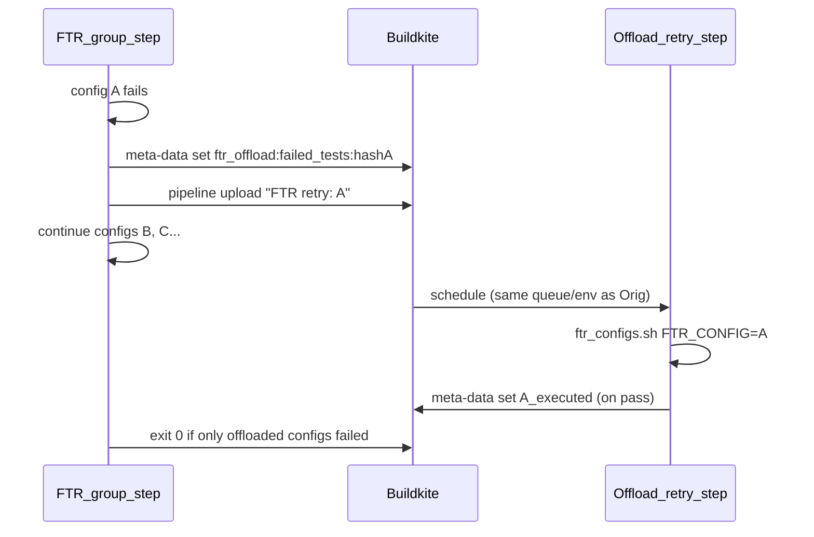

# FTR early config retry (dynamic upload)

## Flow

- The uploaded step is a regular step, not a soft-fail one, so it alone decides pass or fail for config A. We need no warm node, queue, heartbeat or claim logic. Buildkite handles scheduling and infra retries.
- If the upload itself fails, we fall back to today's behavior: config A stays in `failedConfigs`, the step exits 10, and Buildkite retries it.

## Changes

1. **Label mapping:** add `'ci:ftr-early-retry': { FTR_EARLY_RETRY_ENABLED: 'true' }` in [.buildkite/pipeline-utils/pr_labels.ts](.buildkite/pipeline-utils/pr_labels.ts).

2. **Step template:** in [.buildkite/pipeline-utils/ci-stats/pick_test_group_run_order/steps.ts](.buildkite/pipeline-utils/ci-stats/pick_test_group_run_order/steps.ts) `buildFunctionalStepGroup`, add a `FTR_OFFLOAD_STEP_TEMPLATE` env var when the flag is set. It is a JSON blob with `agents`, `timeout_in_minutes`, the env (`ftrExtraArgs` and `envFromLabels`) and `retry: { automatic: [{ exit_status: '-1', limit: RETRIES.INFRA }] }`. There is no `'*'` retry because this step already is the retry. Keeping the template in TS means the bash side doesn't need to know which queue or env a group uses, and offloaded configs run on the same queue as their group. Extend `steps.test.ts`.

3. **Offload helper:** add `ftr_offload.sh`, sourced by [.buildkite/scripts/steps/test/ftr_configs.sh](.buildkite/scripts/steps/test/ftr_configs.sh) the same way `ftr_smart_retry.sh` is. It provides `offload_config "$config"`, which:
   - only runs when `FTR_EARLY_RETRY_ENABLED` is set, `BUILDKITE_RETRY_COUNT == 0`, the run is not a flaky-runner run, and `FTR_CONFIG` is not already set (so retry steps never offload again);
   - collects the failed test names for this one config. It touches a marker file before the config runs, then uses `find -newer` to pick up only that config's junit files, runs `ftr_check_retry_result collect-results --type failures` on them, and stores the result in `ftr_offload:failed_tests:<hash>`;
   - builds a step from the template with key `ftr-offload-<groupKey>-<hash8>`, label `FTR retry: <config>` and env `FTR_CONFIG=<config>`, `FTR_CONFIG_GROUP_KEY=<same key>` and `FTR_OFFLOAD_FAILED_TESTS_KEY=ftr_offload:failed_tests:<hash>`, then pipes it to `buildkite-agent pipeline upload`;
   - writes `cancel_on_gate_failure_batch:ftr_offload_<hash8>` so gate-failure cancellation also covers the new step. There is one key per step so each key has a single writer;
   - returns non-zero if the upload fails, so the caller keeps the config in `failedConfigs`.

4. **`ftr_configs.sh` failure branch:** if `offload_config` succeeds, log `[offloaded]`, add the config to the results summary, and don't add it to `failedConfigs` or set `exitCode=10`. Otherwise keep the current behavior.

5. **Smart-retry parity:** in [.buildkite/scripts/steps/test/ftr_smart_retry.sh](.buildkite/scripts/steps/test/ftr_smart_retry.sh), when `FTR_OFFLOAD_FAILED_TESTS_KEY` is set, `apply_smart_retry` reads the previously failing tests from that key and runs on attempt 0. Without this, an offloaded retry would be stricter than today's smart retry and could turn builds red that are green today.

6. **Docs:** add a short section on the label and its limits to [.buildkite/scripts/pipelines/pull_request/README.md](.buildkite/scripts/pipelines/pull_request/README.md).

## Gotchas to verify during implementation

- [.buildkite/pipelines/es_snapshots/verify.yml](.buildkite/pipelines/es_snapshots/verify.yml) and `fleet/package_registry.yml` declare `depends_on: ftr-configs`. Uploaded steps are not part of that group, so a failed offload would not block those dependents. Only enable the flag where nothing gates on `ftr-configs`: the PR pipeline through the label, never `on_merge` or the ES snapshot promotion pipelines.
- Check where Buildkite inserts uploaded steps relative to later `wait` steps such as post-build or failed-test reporting. If they land after a `wait`, add explicit `depends_on` or move the reporting.
- Check that failed-test reporting and annotations still fire for the original job when it exits 0 with offloaded failures.

## Checks

- Jest: `steps.test.ts` covers the template being present or absent based on the flag, and `pr_labels` covers the label mapping.
- Manual test on a draft PR with `ci:ftr-early-retry` and a deliberately flaky config. Confirm the retry step appears mid-group, the original step goes green, and a failure in the retry step turns the build red.

## Later (not in this plan)

- Warm standby runner as an optimization to skip the 3–5 minute cold start, if real data shows that time matters.
- Scout lanes, using the same pattern.
